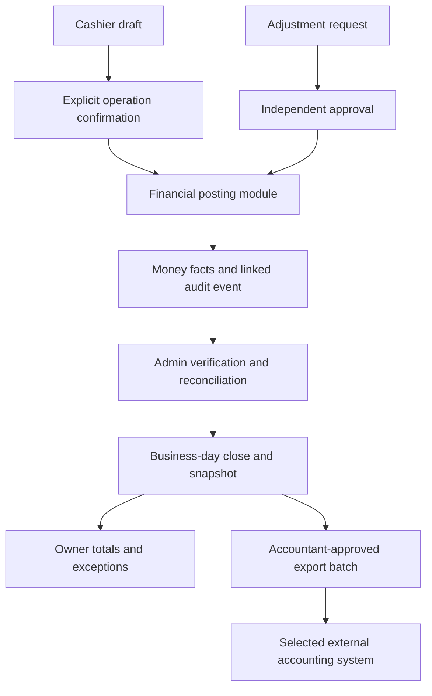

# Sedona cashier, accounting, and audit integration plan

Review date: 8 October 2026 (Asia/Singapore). Target: `C:\xampp\htdocs\sedona-v3`.

Status: Phases 1-4 and the local Phase 5 invoice-configuration and reviewed CSV workflows are implemented in v3. Activation of configured invoices/exports requires actual approved business details. External API synchronization awaits a selected destination and credentials. The findings below record the source reviewed on 8 October 2026. Implementation progress is recorded separately below. Comparisons use the primary vendor documentation linked in this plan; proposed controls are adapted to Sedona, rather than a claim that every hotel system implements them identically.

## Implementation progress — 8 October 2026

Phase 1 now requires an open, unfrozen shift for monetary posting and uses the shift opener as drawer custodian. Cashiers can settle any permitted guest folio using their own drawer; folio ownership does not prevent shared front-desk work. Admin/owner operations on another cashier's drawer require a reason and write a `shift.override` audit event in the same local transaction. Outside-shift payment posting is blocked. Noncash approved write-offs keep their existing handling.

Payment posting, POS sale posting, kitchen status, property-wide shift review, and drawer overrides have separate permissions. Kitchen staff retain fulfillment access and cannot post POS sales. Cashiers see closed shifts they opened, closed, or participated in; prior participation does not grant access to another cashier's live drawer. Closing an unauthorized drawer is rejected before validation, and repeating a close cannot replace its saved count.

The open-shift GCash display now uses current collections; admin variance uses the saved cash variance and displays expected cash separately. Open shifts show pending count/close status. The current closeout is accurately labeled counted closeout. Loss reporting no longer claims independent auditing or identifies the check-in operator as an unrecorded write-off requester.

The permission migration upgrades existing standard roles without running the account seeder. It preserves revoked legacy operation access and leaves kitchen sales prohibited. A consistent SQLite backup was restored into memory and passed an integrity check before migration. Folio, order, payment-entry, expense, and shift row counts remained unchanged after migration.

Validation: 157 PHP tests passed with 1,069 assertions; 9 JavaScript tests passed. The production asset build, required Pint formatting, and whitespace checks passed. Twenty-four cashier-control cases cover permissions, custody, absent/frozen shifts, historical participation, override reasons, safe close retries, and atomic rollback of stock and audit records.

Backup: `C:/xampp/htdocs/sedona-v3/storage/app/private/sedona-phase1-before-permissions-20261008-014914.sqlite` (private local storage).

Phase 2 now separates actual deposit collection from settlement drafts. The received-deposit display is read-only; a confirmed collection adds an amount with its payment method, cashier, shift, and GCash reference. Autosaves and print-preview query parameters cannot create, reduce, or substitute received deposits. Refunds remain explicit transactions after checkout and cannot exceed the remaining balance.

Checkout, POS orders, quick add-ons, deposits, refunds, and financial-document print requests require a stable UUID operation key. The database reserves a unique key before financial or inventory state changes, and commits the request fingerprint, result, business records, and audit together. Repeating the same actor/action/source/payload returns the recorded outcome; changing the payload or reusing another actor's key is rejected. Keys from failed operations roll back and can be retried. Forms hold their key across retries of that submission; starting a new submission creates a new key.

`FinancialPostingService` records folio settlements/deposits/refunds/write-offs and walk-in POS in the payment journal. Walk-in entries link to their Order, while reports retain unjournaled historical Orders as a fallback, avoiding duplicate collections. Original payment entries cannot be updated or deleted through the application model. Deposit refunds link to original recorded deposit entries through amount allocations; the unallocated legacy portion remains identified as unknown rather than receiving invented provenance. General sale voids/corrections and their approvals remain Phase 3 work.

GCash references are recorded per journal movement and may allocate one provider reference across multiple payments. Those allocations are recorded claims, with no provider verification asserted. Provider statement matching and checking allocated totals against actual transfers remain Phase 4 work.

The **Transactions & Audit** navigation item opens paginated, searchable histories with date, kind, and shift filters. Cashiers and managers see their own money movements and audit events; admin/owner accounts retaining property-review permission can see the property history. Existing unjournaled settlements, POS, and drawer expenses remain accessible and identify missing shift/actor information. Audit events cover payment posting, settlement draft edits, room-charge orders/add-ons, drawer overrides, shift open/close, expense recording/deletion, and receipt/deposit/refund print requests. Expense deletion is currently audited with a retained snapshot; replacing it with approved reversals remains Phase 3 work.

Financial-document GET pages are previews. The print-request POST records a copy number and displays a first-recorded-request/copy label before opening the print dialog. Retrying that request does not increment the count. These events do not confirm paper printing, and the first recorded request does not assert that a historical document was never printed before this upgrade. Application audit records are append-only through these endpoints, with no claim of protection from direct database administration. Approval history will expand with the approval workflows in Phase 3.

Phase 2 validation: **175 PHP tests passed with 1,214 assertions**, including 18 new posting/history cases; **9 JavaScript tests passed**. Required Pint formatting, production asset build, and whitespace checks passed. Tests cover retry outcomes, changed-payload/actor rejection, atomic audit-failure rollback, stock consumption, mixed legacy/journal collections, signed refunds and allocations, reference requirements, scoped history, date filters/pagination, immutable entries, and print-copy tracking. Existing billing and workflow tests pass. In-browser verification was blocked by the browser URL policy; no financial transactions were entered into the live database during verification.

Phase 2 backup: `C:/xampp/htdocs/sedona-v3/storage/app/private/sedona-phase2-before-journal-20261008-194711.sqlite`. The consistent SQLite backup was restored into memory and passed its integrity check. Both journal migrations were applied without reseeding. A post-migration integrity check passed, and checksums of every existing column and row in folios, orders, payments, expenses, shifts, audits, accounts, POS items, inventory events, and rooms matched the backup. Counts preserved: 2 folios, 1 order, 1 payment entry, 0 expenses, 0 shifts, 12 accounts, 71 POS items, 1 inventory event, and 32 rooms. The local v3 preview was restarted.

The Phase 2 pending items were implemented in the following Phases 3-5 update. Current guest billing rules remain unchanged.

## Phases 3-5 implementation — 8 October 2026

The Approvals & Tasks screen now supports recorded rate/time and discretionary-discount overrides, write-offs, deposit/POS refunds, inventory adjustments/recounts, cash drops, float additions, bank deposits, paid-expense review and cash-return reversals. A different admin/owner reviews each request. Approved source details are rechecked under lock at execution; changes invalidate the approval. Execution reserves a UUID operation key and commits the result, financial/inventory changes and audit together. Unexecuted requests can be cancelled with a reason and retained history. Actual paid expense reviews cannot be cancelled to hide a payout.

Checkout drafts cannot override the approved room rate or check-in time. New statutory discounts require an ID reference; discretionary changes use the approval queue. Write-offs record the requester, reviewer, executor and approved amount, with a new request required if the balance changes. Refunds link to original payments/allocations and cannot exceed the remaining amount. Financial refunds do not automatically restock consumed food. Recounts retain expected source balances so approval cannot overwrite an intervening sale.

Expenses are retained as actual payments while pending review or rejected. They continue to affect cash count and P&L. Cash-return reversals retain the original voucher and post a linked negative voucher in the current period. Normal endpoints no longer hard-delete expenses. Drops/replenishment/bank deposits are signed custody movements, with references and independent approval. Outgoing counts remain immutable; a different incoming operator records acceptance, which opens a new drawer using the accepted cash. Disagreements require review, and accepted handovers cannot be reused. Outgoing and handover variances remain traceable and enter the accounting batch.

The business day is **6:00 AM to 6:00 AM in Asia/Manila**, as requested. Day closing checks open drawers, unaccepted custody, unreviewed expenses/variances/approvals, unmatched provider/bank movements and unknown legacy provenance. Ongoing guest stays remain open and current hourly billing is unchanged. Closed periods reject late financial writes. Only the owner can reopen a day with a reason. Each close saves another immutable snapshot/version/hash; the Daily Finance screen displays preserved closed snapshots and their history.

GCash/bank CSV import uses the downloadable template: `reference,posted_at,gross_amount,fee_amount,net_amount`. Normalized duplicate rows are skipped; amounts use cents and net must equal gross less fees. A different reviewer matches exact signed totals and references, including multiple PMS allocations of one GCash reference and refund movements. Bank deposits match approved drawer movements. Matched fees enter P&L and exports once. Incorrect unmatched imports can be excluded through independent approval; the original imported row remains. This is local statement reconciliation and makes no claim of live provider verification.

Deposit reporting separates journal-supported balances from outstanding legacy balances. Application consumes the pre-existing legacy portion before later journal deposits; refund allocations exclude already-applied deposit amounts. Legacy origins are still labeled unknown. Unresolved legacy opening balances block close/export rather than receiving fabricated collection history.

Owner setup records the actual legal name/address/TIN/registration, approved invoice series and sequence, tax treatment/rate, accountant approval reference, opening-balance reference, destination and account mappings. Invoice/export activation defaults to disabled. Invoices retain immutable source/issuer/tax/payment snapshots, unique numbers, and audited print-request copies. VAT on statutory-discount folios requires an independently approved taxable amount and evidence reference. That recorded tax basis does not change the guest bill. Hardcoded TIN and assumed 12% VAT wording were removed from normal settlement documents and reporting; these workflows do not certify legal compliance or an approved government invoice format.

Closed, reconciled periods generate balanced accounting CSV batches with source IDs and stable external line keys. The outbox requires a different reviewer before download, returns its original stored batch on retry, and records manual delivery acknowledgment/history. Mapping covers earned room/dining/overtime/surcharge revenue, discounts, write-offs, sales returns, deposit liabilities, cash, clearing, safe/bank, fees, expenses, approved tax and cash variances. Partial sale refunds reverse their proportional invoice tax without accumulating rounding drift. Reopened delivered periods create linked correction batches that reverse the previous full snapshot and post the replacement. Old superseded batches cannot be delivered again.

**Remaining activation:** enter the accountant-approved facts and reconcile existing legacy opening balances before enabling invoice/export issuance. Reviewed CSV delivery is manual. No external accounting API is connected; supported API implementation depends on selecting the destination and providing authorized access. No invented registration, mappings, bank/provider matches, or external delivery was added to the live database. Trial resets are disabled in v3.

Validation: **213 PHP tests passed with 1,685 assertions**; **9 JavaScript tests passed**. Required Pint formatting, the production asset build, and whitespace checks passed. Regression coverage includes independent review, changed-source rejection, refund limits, custody acceptance and disputes, signed statement matching, cutoff boundaries, closed-period locks and reopening, immutable invoices, balanced exports and linked corrections. Existing guest billing and checkout tests remain green.

The three incremental migrations were rehearsed against a restored consistent SQLite backup before being applied to the local v3 database. Integrity and foreign-key checks passed. Checksums of every original column and row across **26 existing tables** matched the pre-upgrade baseline after migration. Counts preserved include 2 folios, 1 order, 1 payment entry, 12 accounts, 71 POS items and 1 inventory event; there were no expenses or shifts. No reseeding or live financial test transactions were performed. Invoice and export activation remain disabled, with the confirmed cutoff stored as 6:00 AM Asia/Manila.

Backup: `C:/xampp/htdocs/sedona-v3/storage/app/private/sedona-phases3-5-before-upgrade-20261008-205218.sqlite`. Upgrade results: `storage/app/private/phases3-5-upgrade-result.json`. The local app resumed successfully. Browser checks in the existing cashier session verified Front Desk, Approvals & Tasks, and Shifts & Drawer, with no captured browser warnings/errors. Admin/owner finance and setup boundaries were verified through the HTTP feature tests. A witnessed operational pilot with actual drawer counts and accountant-approved setup remains a rollout task.

## Scope and constraints

- Connect cashier transactions to admin verification and owner reporting. External accounting synchronization follows after the underlying records reconcile.
- Preserve current room prices and layout, the 12-hour promo, immediate rounded-up overtime, and the current PHP 130 hourly overtime charge. Do not restore the legacy billing rules.
- Preserve the original `C:\xampp\htdocs\sedona` folder. Implement later work in v3 through incremental changes, with no trial reset or destructive database rebuild.
- Retain the current one-open-shift, shared-drawer model initially. Agree who has custody and how custody transfers before enforcing cashier assignment.
- Reuse the existing Laravel, Spatie permissions, billing, inventory, and reporting structure. No new dependencies or top-level application folders are proposed.
- Daily accounting close must support hourly stays crossing midnight. It must not force guests to check out or introduce nightly hotel charges.

## What the cashier already has

The system already supports reservation-to-folio check-in, walk-in check-in, extensions, room transfers, discounts, room charges, POS orders, inventory consumption, and kitchen order status. Reservation check-in is not a missing feature.

Room settlement supports cash, GCash, and split payment, with actual tenders and change, insufficient-payment checks, and protection against repeating a completed checkout. Walk-in POS supports cash and GCash. Deposit collection and refund entries, remaining-deposit checks, opening floats, denomination counts, recorded closing variance, remittance slips, and printable transaction documents also exist.

Existing tests cover important billing, checkout, deposit, inventory, and shift boundaries. Those protections should be extended, rather than replaced with a new transaction flow that loses them.

## Cashier findings

Priority means implementation order: **P1** affects money integrity, authority, or custody; **P2** improves reconciliation and daily operation. Source links point to the reviewed files in v3.

| ID | Priority | Verified gap | Proposed result | Source |
| --- | --- | --- | --- | --- |
| C01 | P1 | Folio money entries and walk-in POS sales allow a null shift; they reject a frozen shift but do not require an open one. | Require an authorized operating shift for ordinary monetary posting. Any outside-shift exception needs explicit authority, a reason, and a visible reconciliation queue. | [Folio posting](C:/xampp/htdocs/sedona-v3/app/Http/Controllers/CheckInController.php:361), [POS posting](C:/xampp/htdocs/sedona-v3/app/Http/Controllers/PosController.php:176) |
| C02 | P1 | Any user with shift-management access can close the shared shift; cashier shift history is global. Remittance access does not check drawer participation. | Record custody and handover; authorize closing against the assigned operator or a recorded override. Restrict cashier financial history to their shifts and participation. Keep shared guest operations available as required. | [ShiftController](C:/xampp/htdocs/sedona-v3/app/Http/Controllers/ShiftController.php:20): `index`, `closeShift`, `showRemittanceSlip`; [routes](C:/xampp/htdocs/sedona-v3/routes/web.php:83) |
| C03 | P1 | Open-shift GCash uses the stored closing field, which is only populated when the shift closes. Admin variance subtracts gross revenue from counted cash. | Use live financial summaries while open, and recorded snapshots after close. Admin variance must use `cash_variance`, rather than revenue. | [Live GCash](C:/xampp/htdocs/sedona-v3/resources/views/shifts/index.blade.php:89), [admin variance](C:/xampp/htdocs/sedona-v3/resources/views/accounting/shifts.blade.php:51), [stored close](C:/xampp/htdocs/sedona-v3/app/Http/Controllers/ShiftController.php:112) |
| C04 | P1 | The form calls closeout "blind" while showing expected drawer cash before counting. | Either label it accurately or implement agreed blind counting: lock the count before revealing expected cash. Remove that information from the response and overlapping reports, not only from visible HTML. | [Expected amount](C:/xampp/htdocs/sedona-v3/resources/views/shifts/index.blade.php:82), [count form](C:/xampp/htdocs/sedona-v3/resources/views/shifts/index.blade.php:143) |
| C05 | P1 | Editing the deposit in the checkout draft immediately posts a deposit or refund. A draft edit is treated as actual money movement. | Keep draft values separate. Collect/refund only through explicit confirmed actions recording amount, method, actor, shift, and reference. Retain autosave ordering and checkout replay protections. | [Draft posting](C:/xampp/htdocs/sedona-v3/app/Http/Controllers/CheckInController.php:319); `updateDeposit`, `refundDeposit` in the same controller |
| C06 | P1 | Checkout draft updates can change room charge and check-in time. Discounts and these overrides lack a complete requester, reason, reviewer, and change history. Force checkout has approval but incomplete request history. | Use policy-based eligibility for statutory discounts; require documented approval for discretionary discounts, rate/time overrides, and write-offs. Record request and execution separately. Preserve billing formulas. | [Draft validation and application](C:/xampp/htdocs/sedona-v3/app/Http/Controllers/CheckInController.php:307), [discount action](C:/xampp/htdocs/sedona-v3/app/Http/Controllers/CheckInController.php:136) |
| C07 | P1 | Cashier expenses are immediately approved. Stock adjustments/recounts can directly change quantities. There is no general sale void/refund approval flow. | Add request, approve, and execute actions for expenses, refunds, voids, and stock adjustments, with evidence and reversal links. Deposit refunds already exist and should keep their balance checks. | [Cashier expenses](C:/xampp/htdocs/sedona-v3/app/Http/Controllers/ShiftController.php:63), [inventory actions](C:/xampp/htdocs/sedona-v3/app/Http/Controllers/InventoryController.php), [POS actions](C:/xampp/htdocs/sedona-v3/app/Http/Controllers/PosController.php) |
| C08 | P1 | Repeating a POS submission can create another sale and stock consumption. GCash references are recorded but not matched to provider transactions; individual deposit movements lack provider references. | Introduce operation keys for safe retries, normalized provider transactions with allocations, and statement verification. Recording a reference must not imply payment verification. | [POS submission](C:/xampp/htdocs/sedona-v3/app/Http/Controllers/PosController.php:129), [resolveSettlement](C:/xampp/htdocs/sedona-v3/app/Http/Controllers/PosController.php:238), [payment entries](C:/xampp/htdocs/sedona-v3/app/Http/Controllers/CheckInController.php:361) |
| C09 | P2 | There is no cash-drop/safe-transfer, float replenishment, or accepted drawer handover record. Logout does not warn about open custody. | Record each custody movement and acceptance. Warn on logout and link to handover; leave the financial shift open until an explicit authorized close. | [ShiftController](C:/xampp/htdocs/sedona-v3/app/Http/Controllers/ShiftController.php), [logout](C:/xampp/htdocs/sedona-v3/app/Http/Controllers/AuthController.php:65) |
| C10 | P2 | Cashiers lack a unified searchable transaction history and queues for pending verification/approval/refund tasks. Receipt reprints have no event history. | Add "My drawer", transaction search, request status, and exception queues. Record document issue/reprint requests with copy labels. A browser print dialog is not proof of physical printing. | Cashier views and [report route permissions](C:/xampp/htdocs/sedona-v3/routes/web.php:92) |
| C11 | P1 | `manage_pos` grants both posting POS sales and changing kitchen status; other permissions also cover broad actions. | Separate payment posting, kitchen status, own/any shift access, refund request/approval, inventory submission/approval, and period reopening. Enforce action policies on the server. | [Seeded permissions](C:/xampp/htdocs/sedona-v3/database/seeders/DatabaseSeeder.php:27), [POS route group](C:/xampp/htdocs/sedona-v3/routes/web.php:74) |

Cloudbeds documents separate privileges for posting without an open drawer, posting into any drawer, closing any drawer, and viewing other users' reports. Its drawer close includes counting, cash drops, carryover, and a logout warning. OPERA documents cashier closure and optional blind cash drops. These comparisons support C01-C04 and C09; Sedona's exact custody policy still needs to be chosen. Sources: [Cloudbeds role privileges](https://myfrontdesk.cloudbeds.com/hc/en-us/articles/19300997644443-Role-privileges), [Cloudbeds drawer close](https://myfrontdesk.cloudbeds.com/hc/en-us/articles/360059266553-Close-Cash-Drawer-and-generate-a-cashier-s-report), [OPERA cashier closure](https://docs.oracle.com/en/industries/hospitality/opera-cloud/25.1/ocsuh/t_cashiers_closure.htm).

## Admin and owner dependencies

| ID | Current gap | Integration requirement |
| --- | --- | --- |
| A01 | Admin shift variance uses counted cash minus gross revenue, despite a correct stored variance at close. | Correct the view immediately and distinguish revenue, cash collections, deposits, GCash, expenses, float, and physical cash. |
| A02 | Expenses are automatically approved and can be permanently deleted through `AccountingController::deleteExpense`. | Preserve original records. Use approvals and linked voids/reversals; prevent later changes from silently rewriting closed reports. |
| A03 | `audit_logs` exists, but no application event writer or review screen is connected. | Record financial/configuration changes and approvals, with actor, time, reason, origin, and approved before/after fields. |
| A04 | The ledger is a latest-records screen limited to 50 folios, 30 walk-in orders, and 30 expenses. | Add complete date-filtered subledgers, opening/closing balances, export reconciliation, and accountant-approved account mapping. A full general ledger can live in the selected accounting system. |
| A05 | There is no formal business-day close, period lock, or payment/bank reconciliation. | Review exceptions, reconcile movements, close the business day, freeze its snapshot, and control reopening. |
| A06 | P&L divides revenue by 1.12; receipt identifiers are not a controlled configurable invoice series. | Confirm tax registration, tax treatment, approved document format/numbering, and accounting recognition with the property's accountant before implementation. Existing printable receipts alone do not establish invoice compliance. |
| A07 | Loss reporting displays a static "100% Signed & Audited" label without a corresponding audit metric. | Display actual requested/approved/executed/reviewed states and outstanding exceptions. |

OPERA documents user change logs and end-of-day controls. Cloudbeds exposes daily guest, deposit, and receivable ledger balances through its trial-balance reporting. These are useful operational comparisons; a PMS ledger balance report is distinct from a complete double-entry general ledger. Sources: [OPERA change log](https://docs.oracle.com/en/industries/hospitality/opera-cloud/25.3/ocsuh/t_logs_viewing_changes_log_details.htm), [OPERA end of day](https://docs.oracle.com/en/industries/hospitality/opera-cloud/25.1/ocsuh/c_endofday_procedures.htm), [Cloudbeds trial balance](https://developers.cloudbeds.com/reference/gettrialbalancereport-1).

## Roles and approval boundaries

| Action | Cashier | Kitchen | Admin / authorized reviewer | Owner | Optional accountant / auditor |
| --- | --- | --- | --- | --- | --- |
| Ordinary payment / POS sale | Post in assigned operating shift | No | Explicit operational permission | Explicit operational permission | Read only |
| Kitchen order status | As operationally permitted | Update status | Review | Review | Read only if needed |
| Discount / override / refund / expense | Submit and view own request; execute only authorized action | No | Approve within assigned limits | Approve reserved/high-value actions | Read only |
| Drawer count / handover | Count own custody; accept incoming custody | No | Review variance; authorized override | Review exceptions | Read only |
| Financial history | Own/participating shifts and permitted guest documents | Order details needed for fulfillment | Property review | Property review | Read/export within granted scope |
| Day close / period reopening | Complete assigned closeout tasks | No | Reconcile and close within policy | Authorize reopening and reserved exceptions | Read only |
| Tax / account mapping / approval limits | No | No | Prepare configuration when permitted | Approve configuration | Advise; changes require granted authority |

An actor must not approve their own request. Approval must bind the amount, reason, original transaction, and allowed action; editing those values requires a new approval. Define a named second reviewer and emergency process for times when only the owner is available. Do not silently grant managers accounting access through this plan; confirm the existing manager role's intended scope.

## Transaction and reporting design

### Modules and interfaces

Keep the existing `BillingService`, `FinancialSummaryService`, and `InventoryService` as the starting modules. Give financial posting a small interface used by folio payment, deposit, POS payment, refund, and cash-custody actions. Its implementation should hide authorization, shift assignment, business date, amount handling, retry keys, journal creation, and audit persistence behind that interface.

The posting module must validate the actor, lock the relevant source/shift, check the operation key and remaining balance, and persist the local financial facts and audit event in one database transaction. Repeating an operation returns its recorded outcome without another payment or inventory deduction. Preserve integer-cent calculation at financial boundaries; use an explicit currency. Keep noncash room charges separate from monetary posting.

Separate seams for approval, reconciliation, and export allow those responsibilities to evolve without copying financial logic into each controller. Use existing `app/Services`, models, requests, policies, controllers, and views. Do not add a generic gateway abstraction or third-party payment adapter until a real provider and supported API are chosen.

An internal rollback cannot undo a payment already received externally. Such a payment needs a recoverable unmatched-provider record and review queue if its application allocation fails. Never tell a cashier that external money was refunded merely because a database transaction rolled back.

### Financial facts and historical compatibility

- Folio money currently comes from `PaymentEntry`; walk-in POS money also comes from `Order` tender fields. Consolidate reporting through one posting source with explicit origin identifiers. Once an order has a journal entry, its legacy tender fields must not be counted again.
- Distinguish money receipt/refund, deposit application, price adjustment, write-off, expense, and custody transfer. Applying an existing deposit is not a second cash receipt. Opening floats and cash drops are not sales.
- Preserve the current completed-stay revenue recognition initially: room and room-charged dining totals enter reports at checkout; walk-in dining enters at order posting. Deposits and collection totals need their own balances. Any later accounting-policy change needs explicit agreement and reconciliation.
- Preserve closed-shift figures as immutable snapshots. Subsequent corrections are linked movements in an open period, or require an authorized reopening; they must not quietly change the old report.
- Historical null-shift records currently fall into time-window report fallbacks. Keep their provenance and reconcile them; do not invent an operator, approval, reference, or backdated shift assignment.
- Existing source records must retain links to new entries. Migration must not generate duplicate payments for already-journaled folios or fabricate GCash verification.

### Proposed data additions, subject to schema inspection

| Record | Minimum information / purpose |
| --- | --- |
| Financial operation and journal | Stable operation key, origin type/id, amount in cents, currency, method, actor, shift, business date, posting time, linked reversal, approval link, and outcome. Separate client retry uniqueness from source-event uniqueness. |
| Provider transaction and allocation | Provider/account/reference, gross amount, fees/net settlement where relevant, status, statement match, and allocation to one or more internal operations. Do not reject a valid shared payment merely because it covers several folio lines. |
| Approval request | Requester, approver, action, source, approved values, reason, evidence reference, policy/limit, requested/decided/executed times, expiry where appropriate, and state. |
| Cash custody movement | Drawer, outgoing/incoming custodian, drop/replenishment/handover amount, count, safe reference, acceptance, and linked shift. |
| Audit event | Actor and role context, event, source, server time, operation/request link, reason, and whitelisted before/after values. Reuse the existing audit table where suitable. |
| Business-day close / period snapshot | Business date and cutoff, totals by method, deposit/guest balances, unresolved exceptions, reviewer, close time, and reopening history. |
| Export batch / outbox | Stable batch/line IDs, closed-period source links, mapping version, destination, status, attempts, external IDs, totals, and error/reconciliation details. |

Keep audit events append-only through application permissions. This does not make them tamper-proof against a database administrator; backups and separately retained exports provide additional evidence. Exclude passwords, session tokens, full identity documents, and unnecessary personal data from audit values. Protect uploaded evidence with authorized access and a retention policy.

Expense authorization and actual cash disbursement must be separate facts: an unpaid pending request must not reduce drawer cash, while money already paid out must reduce cash even if approval is still pending. That situation becomes a review exception, rather than disappearing from the expected drawer amount.

## Delivery phases and acceptance gates

### Phase 1 — Correct current visibility and authority (implemented)

Address C01-C04, C11, A01, and A07. Correct live GCash and variance display; label revenue versus collections; replace unsupported audit claims. Split kitchen/payment permissions, scope cashier history, agree custody, and require an authorized open shift. Deliver a usable "My drawer" summary in the same phase. Choose honest counted-close labeling or true blind-count behavior.

**Gate:** cash plus opening float, deposit receipts/refunds, expenses, and GCash produce the correct distinct totals. Unauthorized actors and no-shift/frozen-shift money posting fail without changing folios, orders, payments, or stock. Ordinary shared guest operations still work. Closed totals remain unchanged. A saved count cannot be silently overwritten.

### Phase 2 — Unify financial records and audit (implemented)

Address C05, C08, A03, and the posting foundation for A04. Introduce explicit deposit collection/refund actions, operation keys, source-linked money facts, provider references/allocations, and audit events. Integrate folio payments and walk-in POS without double-counting. Deliver searchable cashier transaction history and recorded receipt reprint requests.

**Gate:** repeated POS, deposit, settlement, and refund submissions return the same result; no duplicate cash movement, order, or stock deduction occurs. Reversals retain the original. Posting and audit persistence either succeed together or leave no partial local state. Historical/new records reconcile by date, method, and source, with legacy unknowns identified.

### Phase 3 — Approvals and drawer custody (implemented)

Address C06-C07 and C09-C10, plus A02. Deliver request/review/execute screens for rate/time overrides, discretionary discounts, write-offs, refunds, expenses, and inventory adjustments. Add evidence references, safe drops, replenishment, outgoing counts, incoming acceptance, and logout guidance. Cashiers see request outcomes and tasks; reviewers see aging and exceptions.

**Gate:** self-approval is rejected; approval cannot be reused for a changed amount/source or repeated execution. Partial refunds cannot exceed the original unreversed payment or remaining deposit, including concurrent attempts. Stock returns only reflect actual returned goods; consumed food and spoilage are not automatically restocked by a financial refund. Unapproved actual cash-outs remain visible. Historical expenses cannot be hard-deleted through normal workflows.

### Phase 4 — Reconciliation and business-day close (implemented)

Address A04-A05. Deliver daily payment-by-method and deposit/guest-balance reports; import or enter GCash/bank settlement statements; match transactions, fees, unmatched receipts, and refunds. Add day-close checks, snapshots, period locks, authorized reopening, and owner exception dashboards. Support ongoing stays crossing the cutoff.

**Gate:** opening balances plus movements reconcile to closing balances. Physical cash variance excludes GCash and includes custody movements. Deposit liabilities reconcile to folio balances. Duplicate statement imports do not duplicate matches. Late expenses, refunds, and adjustments cannot silently rewrite a closed period. Reopening records the approver, reason, and replacement snapshot/version. No close procedure changes hourly billing or forces checkout.

### Phase 5 — Invoice setup and accounting export (local workflows implemented; activation and API pending)

Address A06 and external integration. Confirm accountant-approved tax treatment, document numbering/format, revenue recognition, and account mappings before enabling them. Start with reviewed CSV exports from reconciled, closed periods. Map room/dining revenue, discounts, write-offs, deposits, cash, provider clearing/fees, expenses, and tax as appropriate to the approved accounting policy.

Choose the destination with the user/accountant: for example, QuickBooks, Xero, or the accountant's existing package. Add API synchronization only after its supported interface and merchant/accounting access are verified. Use an export outbox, stable external keys where supported, status/history, retry controls, and destination reconciliation. Block automatic export of unresolved batches rather than guessing missing mappings.

**Gate:** export totals reconcile to the closed PMS subledgers, with no duplicated legacy/new transactions. Approved mappings produce balanced accounting batches where required by the destination. Failed/time-out retries cannot duplicate a batch; if the destination lacks idempotency, check the prior outcome before replay. Corrections use linked adjustment batches. Trace an external line back to the original cashier transaction and approval.

Cloudbeds' QuickBooks integration documents account/category mappings and synchronization history. That supports the proposed mapping and traceability requirements; it does not establish which external product is right for Sedona. Source: [Cloudbeds QuickBooks integration](https://myfrontdesk.cloudbeds.com/hc/en-us/articles/14006341059867-How-to-connect-Quickbooks-to-Cloudbeds-PMS).

### Later options — Only after core controls reconcile

Supplier purchasing/payables and inventory costing; corporate receivable aging and partial-credit settlement; reservation advances and cancellation/no-show policies; room cleaning/inspection readiness; profitability forecasts. Reservation check-in already exists. These additions depend on the property's operating needs and should not delay the core cashier controls.

## Test and review approach

Extend the existing PHPUnit feature tests and relevant frontend tests when each behavior changes. Use the narrowest affected tests during development, then required project checks at the integration gate. Do not write new tests solely for static labels/layout.

Cover unauthorized roles/shift custody, absent/frozen/closed shifts, integer-cent boundaries, duplicate and concurrent operations, refund limits, approved-value changes, atomic inventory rollback, audit persistence, and cashier history scope. Cover real blind-count response restrictions if selected, opening float/cash-drop reconciliation, cross-midnight stays, period locks/reopening, legacy fallback de-duplication, provider allocations, and ambiguous export retries. Verify existing billing, reservation check-in, checkout, and deposit tests remain green.

Review exports and accounting mappings with the accountant using representative transactions, including a deposit collected in one shift, applied in another, a split settlement, a GCash refund, and a late adjustment after period close. The initial review was static; Phase 1 implementation verification is recorded above.

## Rollout and rollback

1. Record the starting schema/application version. Back up SQLite and uploaded evidence; verify the backup can be restored in an isolated copy.
2. Inventory existing folios, orders, payment entries, expenses, shifts, and audit data. Save baseline totals by date, method, and source.
3. Apply incremental migrations in a copy first. Backfill only facts supported by existing records. Tag unknown provenance and unresolved discrepancies for review; do not fabricate approval history or provider matches.
4. Compare old and proposed summaries. Reconcile every difference, particularly deposit application, write-offs, walk-in tenders, legacy folios, and null-shift time-window fallbacks. Block cutover on unexplained money differences.
5. Pilot one drawer and complete a witnessed count, handover, day close, and reviewed export. Train cashier/admin/owner users on the new queues and custody responsibilities.
6. Cut over with verified backups and versioned migration/report mappings. A rollback after new transactions exist must preserve those transactions and reconcile them; restoring an old database alone would lose money records.
7. Restrict trial/reset tooling, including `pms:clean-trial`, in any environment carrying real financial records. Do not use `migrate:fresh` or a trial reset as an upgrade step.

## Decisions required before dependent implementation

These are configuration/business decisions, not blockers for the completed review and plan. Agree each one before the phase that depends on it.

| Decision | Required before |
| --- | --- |
| Drawer opener holds custody; admin/owner cover requires a recorded reason. A different incoming operator accepts the recorded handover and opens the next drawer with the accepted cash. | Implemented Phases 1 and 3 defaults |
| Current counts are counted closeout with expected cash visible. True blind counting requires an agreed access policy. | Current Phase 1 default; optional later change |
| Outside-shift monetary posting is blocked. Any future exception needs an explicit policy and review queue. | Current Phase 1 default |
| Approval limits, statutory discount evidence, second reviewer, and emergency override policy | Phase 3 |
| Cutoff confirmed: 6:00 AM Asia/Manila. Unresolved exceptions block close; owner reopening requires a reason and retains snapshots. Retention duration remains a business policy. | Phase 4 implemented defaults |
| GCash/bank statement format and available merchant capabilities; recorded versus verified payment states | Phase 4 |
| Actual tax registration, approved invoice format/series, recognition policy, and chart of accounts | Phase 5 |
| Accounting destination, export format, integration credentials/access, and synchronization frequency | Phase 5 |

Phases 1-4 and the local Phase 5 workflows are implemented. Next rollout steps are a witnessed drawer/day-close pilot, reconciliation of legacy opening balances, and accountant-approved invoice/export activation. External synchronization follows selection of the accounting destination and verification of its supported API and authorized access.
